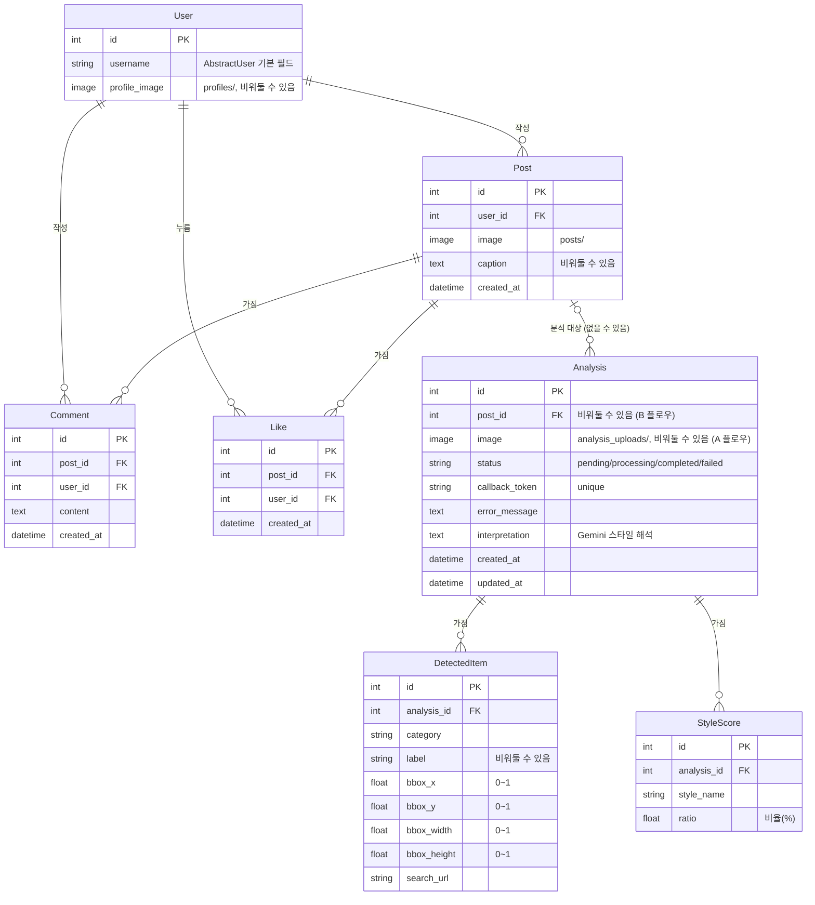

## 4. 모델 설계 (ERD)

### 관계도



> 옵시디언은 mermaid를 기본으로 지원해서 위 코드 블록이 그림으로 보임.
> `||--o{` = 1:N (하나가 여러 개를 가짐), `|o--o{` = 0 또는 1 : N (한쪽이 없을 수도 있음)

텍스트로 그리면:

```
User ─┬─< Post ─┬─< Comment >─ User
      │         ├─< Like    >─ User
      │         └─< Analysis (post는 비워둘 수 있음)
      │                 ├─< DetectedItem
      │                 └─< StyleScore
```

- Comment와 Like는 **Post와 User 양쪽**에 FK로 연결됨 ("어느 글에" + "누가")
- Analysis는 Post에만 연결되고, B 플로우에서는 Post 없이 혼자 존재할 수 있음

### 앱 구조 (모델 관련성 기준 3개 앱으로 분리)

| 앱 | 담당 모델 |
|---|---|
| `accounts` | User |
| `posts` | Post, Comment, Like |
| `analysis` | Analysis, DetectedItem, StyleScore |

---

### accounts.User

```python
from django.contrib.auth.models import AbstractUser

class User(AbstractUser):
    profile_image = models.ImageField(upload_to="profiles/", blank=True, null=True)
```

| 필드 | 타입 | 비고 |
|---|---|---|
| (username, password, email 등) | - | `AbstractUser`가 기본 제공 |
| profile_image | ImageField | upload_to="profiles/", 비워둘 수 있음 |

**`settings.py`에 `AUTH_USER_MODEL = "accounts.User"`를 첫 migrate 전에 지정해야** 나중에 필드를 추가할 때 DB를 갈아엎지 않아도 됨.
→ 실제로 나중에 `profile_image`를 추가할 때 migrate만으로 끝남.

### posts.Post

| 필드 | 타입 | 비고 |
|---|---|---|
| user | FK → User | 작성자, related_name="posts" |
| image | ImageField | upload_to="posts/" |
| caption | TextField | blank=True (캡션 없이 올려도 됨) |
| created_at | DateTimeField | auto_now_add |

### posts.Comment

| 필드 | 타입 | 비고 |
|---|---|---|
| post | FK → Post | related_name="comments" |
| user | FK → User | related_name="comments" |
| content | TextField | |
| created_at | DateTimeField | auto_now_add |

### posts.Like

| 필드 | 타입 | 비고 |
|---|---|---|
| post | FK → Post | related_name="likes" |
| user | FK → User | related_name="likes" |
| created_at | DateTimeField | auto_now_add |
| Meta | `unique_together = ("post", "user")` | 중복 좋아요 방지 |

### analysis.Analysis

| 필드 | 타입 | 비고 |
|---|---|---|
| post | **FK**(1:N, 재분석 허용) → posts.Post | **null=True** (B 플로우는 게시물 없음) |
| image | ImageField | upload_to="analysis_uploads/", **B 플로우에서만 채워짐** |
| status | CharField + choices | pending/processing/completed/failed |
| callback_token | CharField (unique) | FastAPI 콜백 검증용 |
| error_message | TextField | 실패 시 에러 내용 |
| interpretation | TextField | Gemini가 생성한 스타일 해석 글 |
| created_at, updated_at | DateTimeField | auto_now_add / auto_now |

**분석 플로우 2가지**

| 플로우 | 설명 | post | image |
|---|---|---|---|
| A (게시물 기반) | 올린 게시물 사진을 분석 | 채워짐 | 비어 있음 |
| B (독립 업로드) | 게시물 없이 사진만 올려서 분석 | 비어 있음 | 채워짐 |

분석할 사진 위치가 플로우마다 다르기 때문에 `source_image` 속성으로 한 곳에서 정함:

```python
@property
def source_image(self):
    return self.image if self.image else self.post.image
```

→ 직접 올린 사진이 있으면 그걸 쓰고, 없으면 게시물 사진을 씀.

### analysis.DetectedItem

| 필드 | 타입 | 비고 |
|---|---|---|
| analysis | FK → Analysis | related_name="detected_items" |
| category | CharField | 상의/하의/신발 등 |
| label | CharField | 세부 명칭, blank=True |
| bbox_x/y/width/height | FloatField | **0~1 정규화 좌표** (해상도 독립적) |
| search_url | URLField | 쇼핑 검색 링크 |

### analysis.StyleScore

| 필드 | 타입 | 비고 |
|---|---|---|
| analysis | FK → Analysis | related_name="style_scores" |
| style_name | CharField | "캐주얼" 등 |
| ratio | FloatField | 비율(%) |
| Meta | `unique_together = ("analysis", "style_name")` | 같은 분석에 같은 스타일 중복 방지 |
